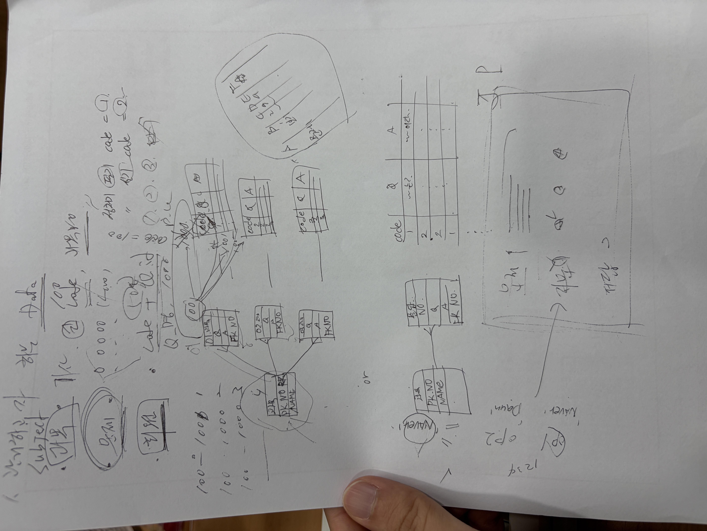
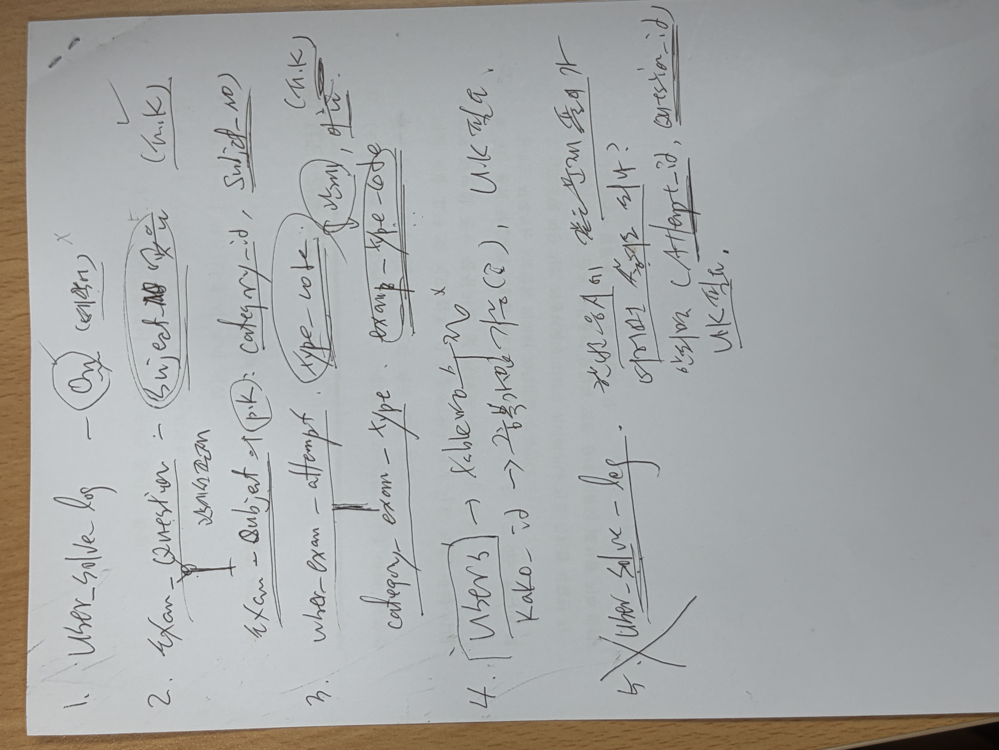

# 자격증공부.com 프로젝트

> 나와 동기들의 자격증 합격을 돕기 위해 시작해, 오라클 DB 설계부터 오라클 클라우드 배포까지 직접 부딪히며 배운 DB관리 프로젝트

---

## 1. 프로젝트를 시작하게 된 계기

정보처리기사, SQLD, OCP, 리눅스마스터 등 자격증 시험을 준비하며 내가 공부할 겸 같이 공부하는 동기들도 언제든 편하게 문제를 풀 수 있는 사이트를 만들어보자는 마음으로 시작했습니다.

처음에는 빠르게 결과물을 낼 수 있는 수파베이스나 버셀 같은 도구를 고민하기도 했습니다. 하지만 DB관리자를 목표로 공부하는 입장에서, 조금 어렵더라도 오라클 데이터베이스를 직접 설계해보고 오라클 클라우드 환경에 배포해보는 경험이 무엇보다 중요하다고 생각했습니다.

프론트엔드나 백엔드 웹 개발의 모든 기술을 완벽히 아는 상태에서 시작한 것은 아니었기에, 부족한 웹 구현과 크롤링 코드는 AI를 적극적으로 활용하여 구축했습니다. 대신 저는 데이터가 어떻게 저장되고 흐르는지 ERD를 설계하고, 클라우드 인프라에서 DB와 스토리지를 어떻게 연결하고 운영하는지를 이해하고 디버깅하며 내 것으로 만드는 데 가장 큰 힘을 쏟았습니다.

---

## 2. 핵심 경험 1 : 오라클 DB 설계 및 ERD 모델링

DB만큼은 직접 설계해보고 싶어서 개념설계부터 테이블설계를 혼자 진행하면서 어려운 부분은 현직자에게 질의와 AI를 통해 설계해보았습니다.

### 1. 하드코딩을 줄이는 마스터 테이블 분리

* 처음에는 화면에 자격증 이름을 직접 적어 넣을까 했지만, 나중에 과목이 추가될 때마다 코드를 고치는 것이 비효율적이라고 느꼈습니다.
* 이를 해결하기 위해 자격증 종목을 담는 `QUESTION_CATEGORY`, 시험 유형을 담는 `CATEGORY_EXAM_TYPE`, 세부 과목을 담는 `EXAM_SUBJECT`를 기준 정보 테이블로 분리했습니다.
* 이렇게 DB 뼈대를 잡아두니 나중에 리눅스마스터 2급 종목을 새로 추가할 때 프론트엔드 코드를 수정하지 않고 오라클 DB에 `INSERT` 문을 실행하는 것만으로 화면에 새 메뉴와 과목이 자동으로 나타나는 메타데이터 기반 설계의 장점을 직접 체감할 수 있었습니다.

### 2. 다양한 시험 형태를 수용하는 보기 테이블 분리

* 일반적인 필기시험은 4지 선다형이지만, 제가 공부하던 오라클 OCP 시험은 보기가 5개에서 8개까지 나오는 문제가 있었습니다.
* 문제 테이블인 `EXAM_QUESTION` 안에 보기 컬럼을 가로로 나열하는 대신, 객관식 보기 저장소인 `QUESTION_OPTIONS`를 별도 테이블로 분리하여 1대N 관계를 맺고 `ON DELETE CASCADE` 제약조건을 설정했습니다. 덕분에 보기 개수가 달라져도 유연하게 데이터를 담을 수 있었습니다.

### 3. 불량 데이터를 막아주는 임시 테이블 활용

* 외부에서 크롤링해 온 엑셀 데이터를 운영 테이블에 바로 넣었다가 에러가 나면 기존 데이터까지 꼬이는 문제가 있었습니다.
* 이를 방지하기 위해 데이터가 먼저 머무는 임시 대기열 테이블인 `QUESTION_STG`를 만들었습니다. 일단 이곳에 데이터를 안전하게 받아둔 뒤, 상태값을 확인하며 정상적인 문제와 보기 데이터만 본 테이블로 넘어가도록 검증 후 적재하는 흐름을 구성하고 연습했습니다.

### 4. 오라클 환경에 맞춘 물리 설계

* 긴 지문이나 HTML 표, 해설을 담아야 하는 `PASSAGE_TEXT`, `EXPLANATION_TEXT` 컬럼에는 오라클의 대용량 텍스트 타입인 `CLOB`을 적용했습니다.
* 또한 사용자의 문제 풀이 기록인 `USER_SOLVE_LOG`와 화면에 보여줄 누적 통계인 `USER_SUBJECT_STATS` 테이블을 나누어, 마이페이지를 조회할 때 DB가 매번 무겁게 계산하지 않도록 구조를 잡아보았습니다.

---

## 3. 핵심 경험 2 : 오라클 클라우드 배포 및 스토리지 활용

로컬 PC에서만 돌아가는 프로젝트로 끝내지 않고, 오라클 클라우드의 여러 기능을 직접 조합하여 24시간 접속 가능한 환경을 구축했습니다.

### 1. 오브젝트 스토리지를 활용한 이미지 분리 저장

* 기출문제에는 표나 그림, 다이어그램 이미지가 많이 포함됩니다. 처음에는 이 이미지를 DB에 직접 넣어야 하나 고민했지만, 무거운 이미지 파일을 DB 내부에 `BLOB` 형태로 직접 쌓으면 DB 용량이 금방 차고 입출력 속도가 느려진다는 것을 알게 되었습니다.
* 이를 해결하기 위해 실제 이미지 파일들은 오라클 클라우드의 오브젝트 스토리지 버킷에 따로 업로드하고, 오라클 DB의 문제 지문 컬럼에는 스토리지의 이미지를 불러오는 가벼운 이미지 태그 주소만 텍스트로 저장했습니다. 클라우드 스토리지와 DB의 역할을 나누어 관리하는 구조를 직접 경험해 볼 수 있었습니다.

### 2. 자율운영 데이터베이스 및 전자 지갑 연동

* 오라클 클라우드의 자율운영 데이터베이스를 생성하고, 보안을 위해 제공되는 전자 지갑 파일을 서버에 세팅하여 Node.js 백엔드와 안전하게 연결하는 과정을 실습했습니다.

### 3. 가상 서버 기반의 24시간 서버 운영

* 오라클 클라우드에서 리눅스 가상 서버를 할당받아 백엔드와 프론트엔드 환경을 올렸습니다.
* 터미널 창을 꺼도 사이트가 종료되지 않도록 프로세스 관리 도구인 PM2를 적용하고, 앞단에 Nginx를 두어 실제 사용자가 언제든 접속해 문제를 풀 수 있는 배포 환경을 완성했습니다.

---

## 4. AI를 활용한 구축, 디버깅 그리고 공부 기록

신입으로서 웹 프론트엔드, 백엔드 API, 웹 크롤러의 모든 코드를 혼자 힘으로 짜기에는 한계가 있었습니다. 따라서 AI를 적극적으로 활용해 전체 뼈대를 구축하고, 발생하는 에러를 함께 디버깅하며 그 안에 담긴 원리를 공부했습니다.

* **대용량 텍스트 적재 에러 디버깅 경험**
  * 크롤링한 기출문제 HTML 지문을 DB에 넣는 과정에서 문자열 길이 초과 에러인 `ORA-01704`를 만났습니다.
  * AI와 함께 원인을 찾으며 오라클 SQL문 안에 직접 적는 문자열은 4,000바이트 제한이 있다는 사실을 배웠고, 이를 해결하기 위해 바인드 변수 방식과 `CLOB` 타입 매핑을 적용하며 오라클의 데이터 처리 방식을 공부할 수 있었습니다.

* **SQL 쿼리 작성 및 분석 함수 학습**
  * 과목별 출제 문항 수에 맞춰 랜덤 모의고사를 뽑아낼 때, 서버에서 복잡하게 섞는 대신 오라클의 `ROW_NUMBER` 분석 함수와 `DBMS_RANDOM.VALUE`를 활용하는 쿼리를 AI의 도움을 받아 적용해 보았습니다.
  * 또한 이어풀기와 오답노트를 구현하며 데이터가 중복으로 쌓이지 않도록 오라클의 `MERGE INTO` 구문이 어떻게 동작하는지 직접 테스트하며 익혔습니다.

* **기출문제 수집 자동화 및 데이터 정제**
  * 동기들이 풀 수 있는 문제를 빠르게 확보하기 위해 AI를 활용해 웹 크롤링 스크립트를 작성하고, 깨진 텍스트나 불필요한 태그를 정규식으로 다듬어 엑셀 양식으로 변환해 DB에 적재하는 전체 과정을 직접 수행했습니다.

---

## 5. 사용 기술 및 환경 요약

| 구분 | 사용 기술 및 도구 | 역할 및 활용 내용 |
| --- | --- | --- |
| Database | Oracle Autonomous DB | 10개 테이블 ERD 설계, 제약조건 설정, SQL 및 PL/SQL 기반 데이터 관리 |
| Cloud / Infra | OCI Compute VM, OCI Object Storage | 리눅스 서버 구축, 문제 이미지 정적 파일 분리 저장, 전자 지갑 보안 연결 |
| Web Server | Node.js, Express, Nginx, PM2 | DB 연동 API 구축 및 24시간 무중단 서비스 환경 구성 |
| Frontend | HTML, CSS, JavaScript | 문제 풀이 화면, OMR 답안지 및 개인 포트폴리오 뷰어 구현 |
| Data / ETC | Puppeteer, xlsx, Kakao OAuth 2.0 | 기출문제 크롤링 및 엑셀 변환, 카카오 소셜 로그인 연동 |

---

## 6. 마무리하며

비록 AI의 도움을 받아가며 완성한 프로젝트이지만, 왜 테이블을 이렇게 나누어야 하는지, 왜 이미지를 DB가 아닌 스토리지에 넣어야 하는지, 클라우드 서버에 DB를 연결해 배포하려면 어떤 과정을 거쳐야 하는지를 처음부터 끝까지 제 손으로 설정하고 에러를 해결하며 배운 소중한 경험이었습니다. 앞으로도 기본기를 탄탄히 다지며 성장하는 DB관리자가 되겠습니다.
